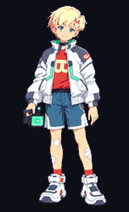
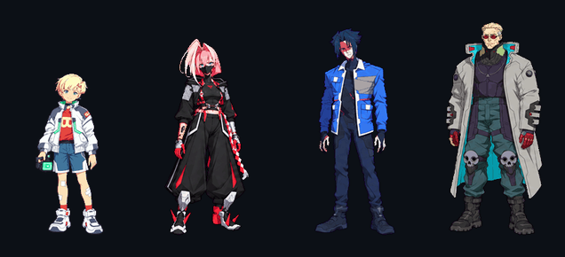

**English** | [Русский](README.ru.md)

# Edgerunners for DeepSeek Harness

Anime companion for [DeepSeek Harness](https://github.com/deepseek-ai/dsh): a hero stands in the corner of the
window, reacts to what the agent is doing, and speaks in character. A compact HUD under the sprite shows the
current action and the file or command the agent is working on.

> **Unofficial adaptation.** This repository is a DeepSeek Harness port of the original mod
> [**Alexanderadon/edgerunners**](https://github.com/Alexanderadon/edgerunners) by
> **Alexander Kurchakov (Alexanderadon)**. Same heroes, clips and lines — re-hosted inside DSH,
> without PowerShell or an external pet process. All credit for the characters, artwork and writing
> goes to the original author.



## Heroes



| Hero | Who | How they talk |
|---|---|---|
| **Roman** | kid blogger with a camera | "MOTOR!", "That's a wrap!", "Into the edit!" |
| **Talia** | cyber ninja, netrunner | "Breaching…", "Clean.", "Into the shadows." |
| **Di** | sleepy mechanic | "Fixing.", "Works — don't touch.", "We'll resolder." |
| **Wick** | veteran fixer | "Working.", "Here's the plan…", "Clean job, kid." |

## Quick install

You need DeepSeek Harness Desktop or Web. No admin rights, no separate process, no terminal.

> **Where to click.** **Plugins** is an entry in the **left sidebar**. It is not
> "Settings → Built-in plugins" — that page only shows what is already installed.
>
> The order is always the same: **Plugins → Add plugin → paste → Install**.

### Option A — from a GitHub link (easiest)

1. In the left sidebar of DSH click **Plugins**.
2. Click **Add plugin** (top right of the Plugins page).
3. Paste this line into the field:

   ```
   github:mordoreay/dsh-edgerunners
   ```

4. Click **Install** and wait until the progress dialog finishes.
5. Find the **Edgerunners** row and make sure its switch is **on**.
6. **Restart DeepSeek Harness** — quit the app completely and open it again. A page refresh
   (`Ctrl+R`) may not reload plugin code, the restart does. After the restart the hero appears in
   the bottom-right corner.

### Option B — from a folder (no git, works offline)

1. On GitHub click **Code → Download ZIP** and unpack the archive.
2. In DSH open **Plugins → Add plugin**.
3. Paste the full path to the unpacked folder — the one that contains `package.json`:

   ```
   C:\Users\you\dsh-edgerunners
   ```

4. Click **Install**, wait, keep the **Edgerunners** row **on**, then **restart DeepSeek Harness**
   (quit completely and open it again) — the page refresh is not enough for plugin code.

### Recommended install (pins the version, allows updates)

Paste this instead of the short link — it installs exactly the published release:

```
git+https://github.com/mordoreay/dsh-edgerunners.git#b970efaa0f1a5c8e70cd97b648f63e1762794779
```

With a pinned commit DSH can offer newer versions in **Discover**.

### After installation

- The hero stands in the corner, the status line is right under it.
- **Settings → Edgerunners** (or the **⚙** button under the hero): hero, size, language, updates.
- To uninstall: **Plugins → Edgerunners → Remove**. Do it there, not by deleting the folder.

### Something went wrong?

| Symptom | What to do |
|---|---|
| `failed to import: ENOENT … bundle\index.js` | The plugin folder was deleted by hand. Restart DSH; if it repeats, **Plugins → Edgerunners → Remove**, restart, install again. |
| No hero after install | **Restart DeepSeek Harness** (a page refresh may not be enough) and check that the Edgerunners switch is on. |
| `Cannot access GitHub` | The network blocks GitHub; use **Option B** with a folder. |

### Install from the plugin index (Discover)

The repository also publishes a plugin market index:

```
https://raw.githubusercontent.com/mordoreay/dsh-edgerunners/main/marketplace.json
```

Add this URL as an index source in the plugin market (Discover) settings of DSH, open the
**Edgerunners** entry and press install. The index pins the exact commit of each version.


## What it does

- **Pet in the window corner** — sprite animation from the original frames, ~49 clips: idle, walk,
  read, type, search, film, fix, dance, laugh, facepalm, scared, sleep and posture transitions.
- **Reacts to tools**: reading a file shows the tablet, searching looks around, editing types, running
  a command plays the hero's signature work, an error is a facepalm, the end of a turn is a celebration.
- **HUD under the character**: hero name, status word and the target the agent is working on
  (file name, search pattern or the first two words of a command; command values are never shown).
- **Click** the pet for a reaction, click the hero name to switch to the next hero.
- **Rest**: after 90 / 160 / 260 seconds without work the hero sits down, lies down and falls asleep.
- **`/persona <hero>`** — pick a hero from the command line (`roman`, `talia`, `di`, `wick`).

## Settings

**Settings → Edgerunners** (or ⚙ under the pet):

| Setting | Values | Notes |
|---|---|---|
| Hero | Roman / Talia / Di / Wick | saved to `~/.dsh/edgerunners.json`, applies instantly |
| Size | 70–400 % | the hero stands at the right edge and grows leftwards |
| Language | Русский / English | lines, HUD statuses, hero names and this page |
| Updates | button | checks the original repository and ports new content |

## Updates from the original

The **Check for updates** button compares the version with
[`.claude-plugin/plugin.json`](https://github.com/Alexanderadon/edgerunners/blob/main/.claude-plugin/plugin.json)
in the original repository, downloads the archive and ports it automatically:

- frames and sounds → `assets/pet/**`, `assets/sounds/**`;
- clips and timings from `hooks/animation.ts` (including per-hero scenes);
- lines for Russian and English from `hooks/deeds.ts`;
- hero names, roles and poke lines from `hooks/characters.ts`.

The sources are parsed in an isolated `node:vm` context: host objects are not shared, string code
generation (`eval`, `new Function`) is disabled, the literal size and parse time are bounded.
Collected data is stored in `~/.dsh/edgerunners-upstream.json` and applied without a restart.

## Security

- Updates are downloaded over HTTPS from `Alexanderadon/edgerunners` only; only
  `assets/pet/**` and `assets/sounds/**` are written, with a hero allow-list and a frame-name pattern.
- Plugin HTTP routes live on the DSH loopback server and accept same-origin requests only;
  other origins get `403`. `POST` must be `application/json`; updates are rate-limited.
- No archive signature or hash pinning: trust extends to the original `main` branch.
  The version and the last check time are visible in the settings.

## Project layout

```
package.json          DSH bundle manifest (host + client halves)
cordis.patch.yml      loader row for the bundle
index.js              host half: tool events, scene, settings, HTTP bridge
brain.js              heroes, clips, lines, deed mapping, autoport data
update.js             version check, archive download, TS literal compilation
client.js             browser half: pet overlay, HUD, settings page
assets/pet/<hero>/    sprite frames (PNG)
docs/DETAIL.md        plugin page (Russian), DETAIL.en.md (English)
locale/               plugin metadata for the Plugins page
```

## Credits and licence

- Original mod, characters, artwork and writing: **Alexander Kurchakov
  ([Alexanderadon](https://github.com/Alexanderadon))** — [original repository](https://github.com/Alexanderadon/edgerunners), MIT.
- DeepSeek Harness adaptation: this repository, MIT. See [LICENSE](LICENSE) and
  [NOTICE.md](NOTICE.md) for third-party attribution.

Fan project. Not affiliated with or endorsed by CD PROJEKT RED, Netflix or Studio Trigger.
Cyberpunk: Edgerunners and its characters belong to their respective owners; the MIT licence covers
the code, not the trademarks or third-party characters.
