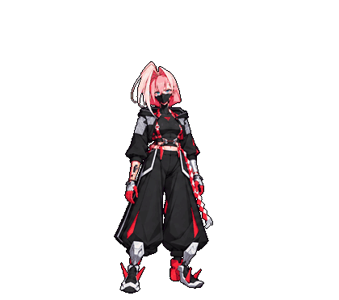

# Edgerunners для DeepSeek Harness

Аниме-напарник для [DeepSeek Harness](https://github.com/deepseek-ai/dsh): герой стоит в углу окна,
реагирует на работу агента и говорит своим голосом. Под спрайтом — короткая строка HUD с текущим
действием и тем, с чем именно работает агент.

> **Неофициальная адаптация.** Этот репозиторий — порт оригинального мода
> [**Alexanderadon/edgerunners**](https://github.com/Alexanderadon/edgerunners) от
> **Александра Курчакова (Alexanderadon)** под DeepSeek Harness. Те же герои, клипы и реплики,
> но рендер внутри окна DSH — без PowerShell и отдельного процесса питомца. Персонажи, арт и тексты
> принадлежат автору оригинала.



*English version: [README.md](README.md).*

## Герои

| Герой | Кто | Как говорит |
|---|---|---|
| **Роман** | мальчишка-блогер с камерой | «Мотор!», «Снято!», «Это в монтаж!» |
| **Талия** | кибер-ниндзя, нетраннер | «Взламываю…», «Чисто.», «Ухожу в тень» |
| **Ди** | сонный механик | «Чиню.», «Работает — не трогай.», «Перепаяем.» |
| **Уик** | бывалый фиксер | «Работаем.», «План такой…», «Чисто сработано, малой.» |

## Быстрая установка

Нужен DeepSeek Harness с поддержкой плагинов (Desktop или Web). Права администратора и отдельные
процессы не требуются.

1. **Скачай папку.** `git clone https://github.com/mordoreay/dsh-edgerunners.git`
   или на GitHub: **Code → Download ZIP**, затем распакуй.
2. **Открой DSH → Настройки → Плагины.**
3. Нажми **Add plugin** и выбери папку, в которой лежит `package.json` (корень репозитория).
4. Убедись, что строка **Edgerunners** включена. Если после установки ничего не появилось —
   обнови страницу (`Ctrl+R`).
5. **Настройки → Edgerunners** — там выбор героя, размера и языка. Та же панель открывается
   кнопкой ⚙ в строке под питомцем.

Удалить плагин можно действием удаления в строке Edgerunners. Вне своей папки плагин хранит только
маленький `edgerunners.json` в домашней папке DSH.

## Что умеет

- **Питомец в углу окна** — анимация из кадров оригинала, около 49 клипов: стойка, ходьба, чтение,
  печать, поиск, съёмка, починка, танец, смех, фейспалм, испуг, сон и переходы между позами.
- **Реагирует на инструменты**: чтение файла — голо-планшет, поиск — оглядывается, правка — печатает,
  команда — фирменная работа героя, ошибка — фейспалм, конец хода — праздник.
- **HUD под персонажем**: имя героя, статус и цель работы (имя файла, шаблон поиска или первые два
  слова команды; значения команд не показываются).
- **Клик** по питомцу — реакция и реплика, клик по имени — следующий герой.
- **Отдых**: через 90 / 160 / 260 секунд без дела герой садится, ложится и засыпает.
- **`/persona <герой>`** — выбор героя командой (`роман`, `талия`, `ди`, `уик`).

## Настройки

**Настройки → Edgerunners** (или ⚙ под питомцем):

| Настройка | Значения | Примечание |
|---|---|---|
| Герой | Роман / Талия / Ди / Уик | сохраняется в `~/.dsh/edgerunners.json`, применяется сразу |
| Размер | 70–400 % | герой стоит у правого края и растёт влево |
| Язык | Русский / English | реплики, статусы HUD, имена героев и эта страница |
| Обновления | кнопка | проверяет оригинальный репозиторий и переносит новое |

## Обновления из оригинала

Кнопка **Проверить обновления** сравнивает версию с
[`.claude-plugin/plugin.json`](https://github.com/Alexanderadon/edgerunners/blob/main/.claude-plugin/plugin.json)
в оригинальном репозитории, скачивает архив и переносит всё автоматически:

- кадры и звуки → `assets/pet/**`, `assets/sounds/**`;
- клипы и тайминги из `hooks/animation.ts` (включая персональные сцены героев);
- реплики для русского и английского из `hooks/deeds.ts`;
- имена, роли и реплики на клик из `hooks/characters.ts`.

Исходники разбираются в изолированном контексте `node:vm`: объекты хоста не передаются, генерация
кода из строк (`eval`, `new Function`) запрещена, размер литерала и время разбора ограничены.
Собранные данные лежат в `~/.dsh/edgerunners-upstream.json` и применяются без перезапуска.

## Безопасность

- Обновления скачиваются только по HTTPS из `Alexanderadon/edgerunners`; пишутся только
  `assets/pet/**` и `assets/sounds/**`, с белым списком героев и шаблоном имён кадров.
- HTTP-маршруты плагина живут на loopback-сервере DSH и принимают только same-origin запросы,
  остальным — `403`. `POST` требует `application/json`, на обновления действует пауза.
- Подпись и хеш архива не проверяются: доверие идёт к ветке `main` оригинала. Версия и время
  последней проверки видны в настройках.

## Структура

```
package.json          манифест бандла DSH (хост и клиент)
cordis.patch.yml      строка загрузчика бандла
index.js              хост: события инструментов, сцена, настройки, HTTP-мост
brain.js              герои, клипы, реплики, разбор дел, данные автопорта
update.js             проверка версии, загрузка архива, разбор TS-литералов
client.js             клиент: оверлей питомца, HUD, страница настроек
assets/pet/<герой>/   кадры спрайтов (PNG)
docs/DETAIL.md        страница плагина (RU), DETAIL.en.md (EN)
locale/               метаданные для страницы «Плагины»
```

## Авторы и лицензия

- Оригинальный мод, персонажи, арт и тексты: **Александр Курчаков
  ([Alexanderadon](https://github.com/Alexanderadon))** — [оригинальный репозиторий](https://github.com/Alexanderadon/edgerunners), MIT.
- Адаптация под DeepSeek Harness: этот репозиторий, MIT. См. [LICENSE](LICENSE).

Фан-проект. Не связан с CD PROJEKT RED, Netflix и Studio Trigger и не одобрен ими.
Cyberpunk: Edgerunners и персонажи принадлежат их владельцам; лицензия MIT покрывает код,
но не товарные знаки и персонажей третьих лиц.
