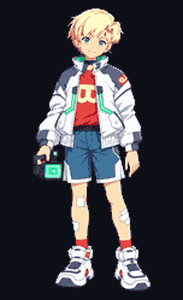

# Edgerunners для DeepSeek Harness

Аниме-напарник для [DeepSeek Harness](https://github.com/deepseek-ai/dsh): герой стоит в углу окна,
реагирует на работу агента и говорит своим голосом. Под спрайтом — короткая строка HUD с текущим
действием и тем, с чем именно работает агент.

> **Неофициальная адаптация.** Этот репозиторий — порт оригинального мода
> [**Alexanderadon/edgerunners**](https://github.com/Alexanderadon/edgerunners) от
> **Александра Курчакова (Alexanderadon)** под DeepSeek Harness. Те же герои, клипы и реплики,
> но рендер внутри окна DSH — без PowerShell и отдельного процесса питомца. Персонажи, арт и тексты
> принадлежат автору оригинала.



*English version: [README.md](README.md).*

## Герои


| Герой | Кто | Как говорит |
|---|---|---|
| **Роман** | мальчишка-блогер с камерой | «Мотор!», «Снято!», «Это в монтаж!» |
| **Талия** | кибер-ниндзя, нетраннер | «Взламываю…», «Чисто.», «Ухожу в тень» |
| **Ди** | сонный механик | «Чиню.», «Работает — не трогай.», «Перепаяем.» |
| **Уик** | бывалый фиксер | «Работаем.», «План такой…», «Чисто сработано, малой.» |

## Быстрая установка

Нужен DeepSeek Harness Desktop или Web. Права администратора, терминал и отдельные процессы не нужны.

> **Куда нажимать.** **Plugins** — это пункт в **левой боковой панели**. Это не «Настройки →
> Встроенные плагины»: там только список уже установленного.
>
> Порядок всегда один: **Plugins → Add plugin → вставить → Install**.

### Способ 1 — по ссылке на GitHub (самый простой)

1. В левой панели DSH нажми **Plugins**.
2. Нажми **Add plugin** (справа сверху на странице Plugins).
3. Вставь в поле эту строку:

   ```
   github:mordoreay/dsh-edgerunners
   ```

4. Нажми **Install** и дождись, пока окно установки закончит работу.
5. Найди строку **Edgerunners** и проверь, что переключатель **включён**.
6. **Перезапусти DeepSeek Harness** — закрой приложение полностью и открой снова. Обновление
   страницы (`Ctrl+R`) может не подхватить код плагина, перезапуск — надёжный способ. После
   перезапуска герой появится в правом нижнем углу.

### Способ 2 — из папки (без git, работает офлайн)

1. На GitHub нажми **Code → Download ZIP** и распакуй архив.
2. В DSH открой **Plugins → Add plugin**.
3. Вставь полный путь к распакованной папке — той, где лежит `package.json`:

   ```
   C:\Users\ты\dsh-edgerunners
   ```

4. Нажми **Install**, дождись конца, оставь строку **Edgerunners** включённой и **перезапусти
   DeepSeek Harness** (закрыть полностью и открыть снова) — обновления страницы для кода плагина
   недостаточно.

### Рекомендуемая установка (фиксирует версию, разрешает обновления)

Вставь эту строку вместо короткой ссылки — установится ровно опубликованный релиз:

```
git+https://github.com/mordoreay/dsh-edgerunners.git#b970efaa0f1a5c8e70cd97b648f63e1762794779
```

С зафиксированным коммитом DSH сможет предлагать новые версии в **Discover**.

### После установки

- Герой стоит в углу, строка статуса — прямо под ним.
- **Настройки → Edgerunners** (или кнопка **⚙** под героем): герой, размер, язык, обновления.
- Удалить: **Plugins → Edgerunners → Remove**. Именно там, а не удалением папки вручную.

### Что-то пошло не так?

| Симптом | Что делать |
|---|---|
| `failed to import: ENOENT … bundle\index.js` | Папку плагина удалили руками. Перезапусти DSH; если повторится — **Plugins → Edgerunners → Remove**, перезапуск, установка заново. |
| После установки нет героя | **Перезапусти DeepSeek Harness** (обновления страницы может не хватить) и проверь, что переключатель Edgerunners включён. |
| `Cannot access GitHub` | Сеть блокирует GitHub; используй **способ 2** с папкой. |

### Установка из индекса плагинов (Discover)

Репозиторий публикует индекс плагинов:

```
https://raw.githubusercontent.com/mordoreay/dsh-edgerunners/main/marketplace.json
```

Добавь этот адрес как источник индекса в настройках рынка плагинов (Discover) в DSH, открой
запись **Edgerunners** и нажми установку. Индекс фиксирует конкретный коммит каждой версии.


## Что умеет

- **Питомец в углу окна** — анимация из кадров оригинала, около 49 клипов: стойка, ходьба, чтение,
  печать, поиск, съёмка, починка, танец, смех, фейспалм, испуг, сон и переходы между позами.
- **Реагирует на инструменты**: чтение файла — голо-планшет, поиск — оглядывается, правка — печатает,
  команда — фирменная работа героя, ошибка — фейспалм, конец хода — праздник.
- **HUD под персонажем**: имя героя, статус и цель работы (имя файла, шаблон поиска или первые два
  слова команды; значения команд не показываются).
- **Клик** по питомцу — реакция и реплика, клик по имени — следующий герой.
- **Отдых**: через 90 / 160 / 260 секунд без дела герой садится, ложится и засыпает.
- **`/persona <герой>`** — выбор героя командой (`роман`, `талия`, `ди`, `уик`).

## Настройки

**Настройки → Edgerunners** (или ⚙ под питомцем):

| Настройка | Значения | Примечание |
|---|---|---|
| Герой | Роман / Талия / Ди / Уик | сохраняется в `~/.dsh/edgerunners.json`, применяется сразу |
| Размер | 70–400 % | герой стоит у правого края и растёт влево |
| Язык | Русский / English | реплики, статусы HUD, имена героев и эта страница |
| Обновления | кнопка | проверяет оригинальный репозиторий и переносит новое |

## Обновления из оригинала

Кнопка **Проверить обновления** сравнивает версию с
[`.claude-plugin/plugin.json`](https://github.com/Alexanderadon/edgerunners/blob/main/.claude-plugin/plugin.json)
в оригинальном репозитории, скачивает архив и переносит всё автоматически:

- кадры и звуки → `assets/pet/**`, `assets/sounds/**`;
- клипы и тайминги из `hooks/animation.ts` (включая персональные сцены героев);
- реплики для русского и английского из `hooks/deeds.ts`;
- имена, роли и реплики на клик из `hooks/characters.ts`.

Исходники разбираются в изолированном контексте `node:vm`: объекты хоста не передаются, генерация
кода из строк (`eval`, `new Function`) запрещена, размер литерала и время разбора ограничены.
Собранные данные лежат в `~/.dsh/edgerunners-upstream.json` и применяются без перезапуска.

## Безопасность

- Обновления скачиваются только по HTTPS из `Alexanderadon/edgerunners`; пишутся только
  `assets/pet/**` и `assets/sounds/**`, с белым списком героев и шаблоном имён кадров.
- HTTP-маршруты плагина живут на loopback-сервере DSH и принимают только same-origin запросы,
  остальным — `403`. `POST` требует `application/json`, на обновления действует пауза.
- Подпись и хеш архива не проверяются: доверие идёт к ветке `main` оригинала. Версия и время
  последней проверки видны в настройках.

## Структура

```
package.json          манифест бандла DSH (хост и клиент)
cordis.patch.yml      строка загрузчика бандла
index.js              хост: события инструментов, сцена, настройки, HTTP-мост
brain.js              герои, клипы, реплики, разбор дел, данные автопорта
update.js             проверка версии, загрузка архива, разбор TS-литералов
client.js             клиент: оверлей питомца, HUD, страница настроек
assets/pet/<герой>/   кадры спрайтов (PNG)
docs/DETAIL.md        страница плагина (RU), DETAIL.en.md (EN)
locale/               метаданные для страницы «Плагины»
```

## Авторы и лицензия

- Оригинальный мод, персонажи, арт и тексты: **Александр Курчаков
  ([Alexanderadon](https://github.com/Alexanderadon))** — [оригинальный репозиторий](https://github.com/Alexanderadon/edgerunners), MIT.
- Адаптация под DeepSeek Harness: этот репозиторий, MIT. См. [LICENSE](LICENSE) и
  [NOTICE.md](NOTICE.md) — там указаны права третьих лиц.

Фан-проект. Не связан с CD PROJEKT RED, Netflix и Studio Trigger и не одобрен ими.
Cyberpunk: Edgerunners и персонажи принадлежат их владельцам; лицензия MIT покрывает код,
но не товарные знаки и персонажей третьих лиц.
